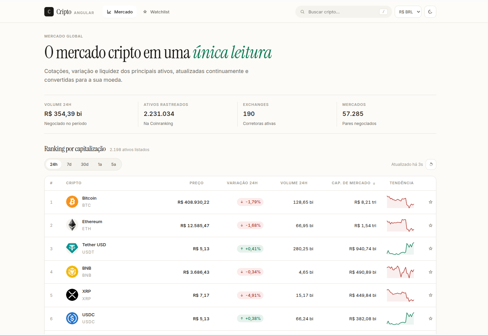
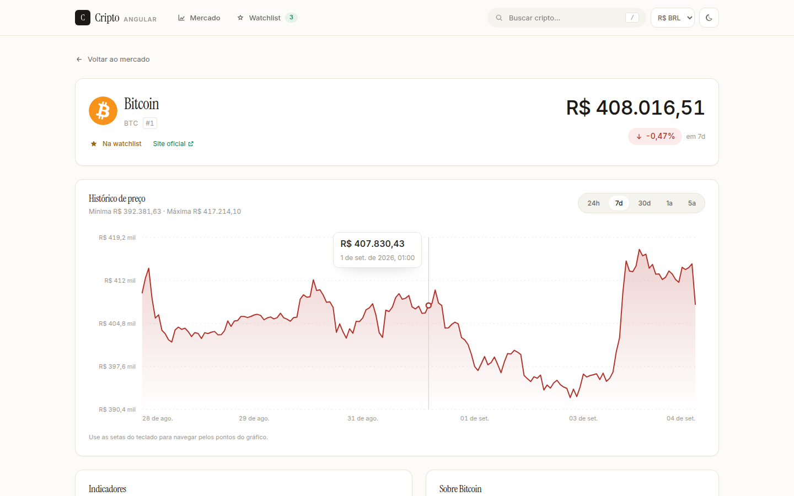
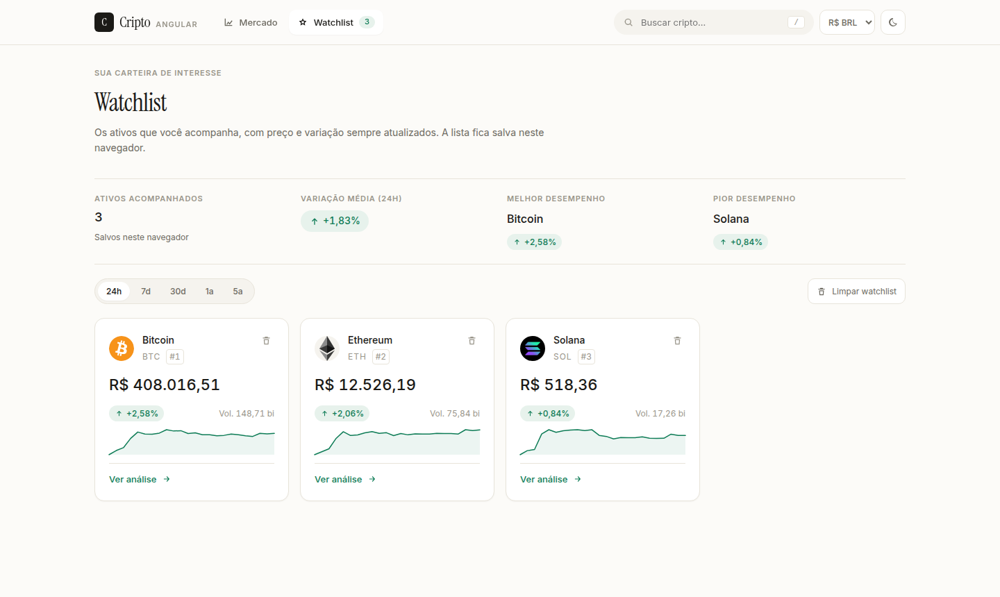
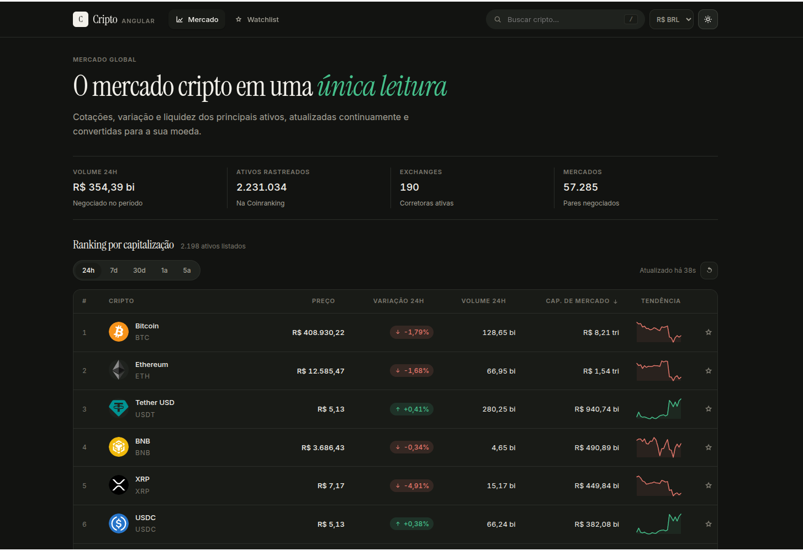

      

# CryptoAngular · Microfrontends

O **CryptoAngular MFE** é a reconstrução do [crypto-angular](https://github.com/dev-araujo/crypto-angular) como uma arquitetura de **microfrontends**: um shell orquestra três aplicações independentes, carregadas em runtime via **Native Federation**, consumindo a API pública da [Coinranking](https://coinranking.com/) para exibir cotações, gráficos e uma watchlist pessoal.



---

## Stack 🚀

**Frontend**

- **Angular (v22)** — standalone, signals, zoneless
- **Native Federation** — composição dos microfrontends em runtime
- **TypeScript (v6)**
- **RxJS**
- **SCSS** com design tokens próprios
- **Vitest**

**API (Externa)**

- **Coinranking API**

> Sem bibliotecas de UI de terceiros: o gráfico, a tabela e todos os componentes são próprios.
> O bundle inicial ficou em **~38 kB comprimido**.

## Arquitetura 🧩

```text
crypto-tracker-mfe/
├── shell/                       # Host: layout, tema, moeda, busca e roteamento   (:4200)
├── remotes/
│   ├── market/                  # Ranking, busca, ordenação e paginação          (:4201)
│   ├── analytics/               # Detalhe do ativo, gráfico e indicadores         (:4202)
│   └── watchlist/               # Ativos acompanhados pelo usuário                (:4203)
├── libs/
│   ├── shared-ui/               # Design tokens + componentes e pipes
│   ├── shared-state/            # Estado compartilhado entre remotes (signals)
│   ├── shared-data-access/      # Models, mappers puros, cliente HTTP e cache
│   └── shared-utils/            # Formatadores e acesso a storage
├── scripts/                     # Geração dos environments e do federation manifest
└── deploy/                      # Uma configuração de deploy por microfrontend
```

O repositório é um monorepo, mas a **independência está no deploy**: cada aplicação tem seu próprio build, sua própria URL e seu próprio projeto na Vercel. O shell resolve os remotes por um manifest lido em runtime — trocar o ambiente de um microfrontend não exige rebuild dos outros.

```typescript
export const routes: Routes = [
  { path: '', pathMatch: 'full', redirectTo: 'market' },
  { path: 'market', loadChildren: loadRemoteRoutes('market', 'Mercado') },
  { path: 'coins', loadChildren: loadRemoteRoutes('analytics', 'Análise') },
  { path: 'watchlist', loadChildren: loadRemoteRoutes('watchlist', 'Watchlist') },
];
```

Se um remote estiver fora do ar, **apenas aquela área** exibe um estado de indisponibilidade — o resto da aplicação continua navegável.

### Fluxo de dados

```text
[Coinranking API] ←→ [CoinApiService] ←→ [Service de domínio] ←→ [Page] ←→ [Componentes puros]
        │                    │                     │
   payload cru          DTO tipado        camelCase + signals
        └──────── mapper (função pura) ────────────┘
```

- `CoinApiService` só faz HTTP e recebe a configuração por injeção.
- Cada remote tem seu **service de domínio** com estado em signals — nenhum componente conhece o modelo cru da API.
- Os **mappers** são funções puras que convertem API ↔ domínio.

### O que é isolado e o que é compartilhado

| Assunto              | Decisão                                                                                       |
| -------------------- | --------------------------------------------------------------------------------------------- |
| Config da API        | Provida nas rotas de cada remote (`provideCryptoApi`) — cada MFE carrega a própria credencial |
| Estado de domínio    | Escopado às rotas do remote, destruído ao sair                                                |
| Estado compartilhado | Moeda, tema, watchlist, busca e notificações — instância única via `sharedMappings`           |
| Estilos              | Tokens CSS globais; componentes usam apenas `var(--token)`                                    |
| Dependências         | `shareAll` com `singleton: true` — uma única instância de Angular e RxJS em runtime           |

### Consumo da API

A quota da Coinranking é finita, então os dados são tratados com cuidado:

- Revalidação automática a cada **120s**, configurável por `DATA_REVALIDATE_INTERVAL_MS`.
- O ciclo **pausa enquanto a aba está oculta** e dispara uma única atualização quando ela volta.
- Cache HTTP em memória com TTL de 60s e deduplicação de requisições simultâneas: trocar período, paginar ou revisitar um ativo dentro da janela não gera nova chamada.
- Os remotes são pré-carregados no hover dos links do header.

## Interface 🎨

Direção **light editorial minimalista**: fundo de papel quente, tipografia serifada nos títulos, algarismos tabulares nos números e um único verde de acento. O tema escuro vem do mesmo conjunto de tokens.

|                                  |                                    |
| -------------------------------- | ---------------------------------- |
|  |  |



Alguns pontos da experiência:

- **Estado na URL**: busca, ordenação, período e paginação são compartilháveis por link.
- **Gráfico próprio em SVG**, com crosshair, tooltip e navegação por teclado.
- **Watchlist** persistida no navegador e sincronizada entre os três microfrontends.
- **Busca global** no header com atalho `/`.
- **Acessibilidade**: skip link, `aria-sort` nas colunas, foco visível, diálogos com foco preso e respeito a `prefers-reduced-motion`.

## Configuração de Ambiente 🔐

Antes de rodar o projeto, é necessário configurar o seu token da API da Coinranking:

1. Crie uma cópia do arquivo `.env.example` e renomeie para `.env`.
2. Abra o arquivo `.env` e insira sua chave da API:

   ```env
   COINRANKING_API_KEY=seu_token_real_aqui
   ```

   _(O arquivo `.env` não é enviado ao GitHub por segurança)._

Os arquivos de environment de cada remote são **gerados** a partir do `.env` e também ficam fora do controle de versão.

> A chave é embutida no bundle do cliente, como na versão original. Para uso público, coloque um proxy no backend e aponte `COINRANKING_BASE_URL` para ele.

## Rodando Localmente ⚡️

Existem duas maneiras de rodar o projeto: **manualmente** ou com **Docker**.

### Manualmente ⚒️

#### 📋 Pré-requisitos

Node 22 ou superior.

1.  Clone o repositório:

    ```bash
    git clone https://github.com/dev-araujo/crypto-tracker-mfe.git
    ```

2.  Instale as dependências:

    ```bash
    npm install
    ```

3.  Execute os servidores de desenvolvimento:

    ```bash
    npm start
    ```

    _Obs: O comando `npm start` gera os environments e o manifest de federação a partir do seu `.env` antes de subir as quatro aplicações._

⭐ A aplicação estará disponível em `http://localhost:4200`.

Para trabalhar em um microfrontend isolado, cada um sobe sozinho com o próprio bootstrap:

```bash
npm run start:market      # ou start:analytics / start:watchlist / start:shell
```

### Com Docker 🐋

#### 📋 Pré-requisitos

Certifique-se de que você tem o [Docker](https://www.docker.com/get-started) e o [Docker Compose](https://docs.docker.com/compose/install/) instalados.

1.  Clone o repositório:

    ```bash
    git clone https://github.com/dev-araujo/crypto-tracker-mfe.git
    ```

2.  Execute o Docker Compose para construir as imagens e iniciar os contêineres.

    ```bash
    docker compose up --build
    ```

⭐ A aplicação estará disponível em `http://localhost:4200`.

## Scripts 📜

| Script                      | O que faz                                                        |
| --------------------------- | ---------------------------------------------------------------- |
| `npm start`                 | Sobe shell + remotes em paralelo                                 |
| `npm run start:<app>`       | Sobe apenas um app (`shell`, `market`, `analytics`, `watchlist`) |
| `npm run build`             | Build de produção dos quatro apps em `dist/<app>/browser`        |
| `npm run build:<app>`       | Build de um único microfrontend                                  |
| `npm test`                  | Suíte completa (Vitest) — libs e apps                            |
| `npm run generate:env`      | Regenera os environments a partir do `.env`                      |
| `npm run generate:manifest` | Regenera o manifest de federação a partir das URLs dos remotes   |
| `npm run format`            | Prettier                                                         |
| `npm run clean`             | Remove `dist` e o cache do Angular                               |

## Deploy 🚢

Está no ar: **https://crypto-mfe-shell.vercel.app**

| Microfrontend | URL                                     |
| ------------- | --------------------------------------- |
| shell (host)  | https://crypto-mfe-shell.vercel.app     |
| market        | https://crypto-mfe-market.vercel.app    |
| analytics     | https://crypto-mfe-analytics.vercel.app |
| watchlist     | https://crypto-mfe-watchlist.vercel.app |

Cada microfrontend é **um projeto Vercel separado**, publicado de forma independente a partir deste mesmo repositório. O que muda entre eles são as configurações de build do projeto:

| Projeto                | Build Command                                                              | Output Directory         |
| ---------------------- | -------------------------------------------------------------------------- | ------------------------ |
| `crypto-mfe-market`    | `npm run generate:env && npm run build:market`                             | `dist/market/browser`    |
| `crypto-mfe-analytics` | `npm run generate:env && npm run build:analytics`                          | `dist/analytics/browser` |
| `crypto-mfe-watchlist` | `npm run generate:env && npm run build:watchlist`                          | `dist/watchlist/browser` |
| `crypto-mfe-shell`     | `npm run generate:env && npm run generate:manifest && npm run build:shell` | `dist/shell/browser`     |

> As configurações vivem **no projeto**, não em arquivos `vercel.json` por app. O `vercel.json` da raiz é compartilhado pelos quatro e carrega apenas o que é comum: o rewrite de SPA e os headers de CORS do `remoteEntry.json`. Um `--local-config` na linha de comando só afeta builds locais — o build remoto lê o `vercel.json` da raiz e ignoraria a configuração por app.

### Variáveis de ambiente

Nos três remotes e no shell:

```env
COINRANKING_API_KEY=...
COINRANKING_BASE_URL=https://api.coinranking.com/v2
```

E, **apenas no shell**, as URLs públicas dos remotes:

```env
MFE_MARKET_URL=https://crypto-mfe-market.vercel.app
MFE_ANALYTICS_URL=https://crypto-mfe-analytics.vercel.app
MFE_WATCHLIST_URL=https://crypto-mfe-watchlist.vercel.app
```

O build do shell gera o `federation.manifest.json` a partir delas. Trocar a URL de um remote é só alterar a variável e republicar **o shell** — os remotes não precisam de rebuild.

### Publicando

Os remotes primeiro, o shell por último:

```bash
vercel deploy --prod --project crypto-mfe-market
vercel deploy --prod --project crypto-mfe-analytics
vercel deploy --prod --project crypto-mfe-watchlist
vercel deploy --prod --project crypto-mfe-shell
```

## Troubleshooting 🩺

**Erros `404` de chunk ou `ngDevMode is not defined` durante o desenvolvimento.**

Acontece quando um build de produção roda com os dev servers no ar: os dois compartilham o cache de artefatos da federação em `.angular/cache`. Pare os servidores e reinicie:

```bash
npm run clean && npm start
```

**O mesmo erro em produção, logo após um deploy.**

É cache do navegador. Se a URL de um microfrontend já serviu outra aplicação, o `index.html` antigo e o import map continuam em cache e se misturam com os chunks novos. Um recarregamento forçado (`Ctrl+Shift+R`) resolve.

---

#### Autor 👷


[Adriano P Araujo](https://www.linkedin.com/in/araujocode/)
